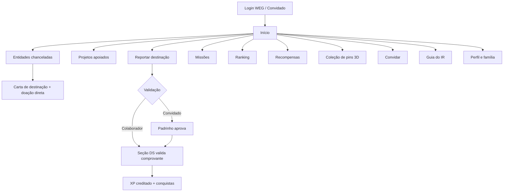

# Prompt para desenvolvimento: App Rede Solidária WEG

> Versão 1.0, outubro de 2026, Seção Desenvolvimento Social | Departamento de Sustentabilidade
> Uso interno. Cole este prompt na ferramenta de desenvolvimento escolhida. Os trechos marcados com **[A CONFIRMAR]** dependem de decisão da equipe ou de dados ainda não fornecidos.

> **Atualizado pela evolução v2** ([`prompt_evolucao_v2_gamificacao.md`](prompt_evolucao_v2_gamificacao.md)): o perfil Convidado, o padrinho, o ranking "Família e Amigos" e a tabela `vinculos_convidado` deixaram de existir. O convidado agora reporta por um link público gerado pelo colaborador, sem cadastro, e o XP vai para o colaborador. A carta segue o modelo oficial (variantes PF e PJ), e a gamificação (níveis, insígnias, missões, ranking, recompensas) passou a seguir as seções 4 a 9 do documento v2. Os trechos abaixo que tratam desses temas valem apenas como histórico.

---

## 1. Papel e objetivo

Você é um desenvolvedor full stack sênior e designer de produto. Construa um aplicativo de uso interno da WEG que funcione **na web (computador) e no celular**, a partir de uma única base de código: web responsiva, mobile-first e instalável no celular como PWA (ícone na tela inicial, tela cheia, notificações). A arquitetura deve permitir empacotar o mesmo código como app nativo para Android e iOS em etapa futura (ex.: Capacitor), sem reescrita. O app é para o programa **Rede Solidária**. O app deve concentrar em um só lugar o reporte das destinações de Imposto de Renda, o acompanhamento da meta institucional, a divulgação dos projetos apoiados, o acesso às entidades chanceladas e uma camada de gamificação que estimule a participação contínua de colaboradores e familiares.

Entregue o app funcional, com dados de exemplo, painel administrativo e autenticação simulada (mock), pronto para receber o login corporativo WEG em uma etapa posterior.

## 2. Contexto do programa

- A Rede Solidária existe desde 2011 e é conduzida pela Seção Desenvolvimento Social da WEG, em Jaraguá do Sul (SC).
- O colaborador destina parte do Imposto de Renda devido aos Fundos dos Direitos da Criança e do Adolescente (FIA) e aos Fundos do Idoso, entre outras leis de incentivo. Não há custo adicional, ele apenas escolhe que parte do imposto permaneça em seu município.
- Em 2026, 211 colaboradores reportaram a destinação e receberam o pin da edição. O pin é colecionável e muda a cada ano.
- Há um evento anual de reconhecimento dos participantes, com entrega de pins e certificados.
- Hoje o reporte é manual. O app substitui esse fluxo e passa a gerar os dados do programa.

## 3. Perfis de acesso

| Perfil | Como entra | O que pode fazer |
|---|---|---|
| **Colaborador** | Login WEG (simulado nesta versão) | Acesso completo: reportar para si e para familiares, missões, ranking, recompensas, convites, coleção de pins, carta de destinação |
| **Convidado** | Cadastro com e-mail pessoal, vinculado obrigatoriamente a um padrinho com e-mail @weg.net | Acesso limitado: página inicial, guia, projetos, entidades, reportar a própria destinação e missões básicas. O cadastro e cada reporte ficam pendentes até a aprovação do padrinho |
| **Embaixador** **[A CONFIRMAR]** | Colaborador marcado pelo administrador | Tudo do colaborador, mais selo de embaixador, missões exclusivas e painel de convites da sua unidade |
| **Administrador** | Equipe da Seção Desenvolvimento Social | Painel administrativo completo (seção 9) |

## 4. Identidade visual e tom

- O app deve transmitir a sobriedade institucional da WEG, com uma camada lúdica de jogo bem dosada.
- Cores institucionais: azul WEG `#00325C` (fundo de cabeçalhos e áreas de destaque) e `#0063A7`. Cores do programa: azul `#095BA7` e ciano `#00BEDF` (realces, barras de progresso, XP).
- **Proibido usar vermelho `#C8102E`** em qualquer elemento. Para estados de erro, use laranja ou âmbar escuro.
- Tipografia: Arial para títulos e Calibri (ou fallback sem serifa equivalente) para textos.
- Mascote: leão azul da Rede Solidária (leãozinho). A arte oficial será fornecida pela equipe e deve ser usada em toda a interface: onboarding, estados vazios, conquistas, subida de nível, guia do IR e notificações. Centralize o mascote em uma pasta `assets/mascote/` e em um componente único `<Mascote variante="..." />`, para que a troca do placeholder pela arte oficial seja feita em um só lugar. Até o envio, use um placeholder neutro em azul `#095BA7`.
- Linguagem em português brasileiro, acolhedora e direta, sem excesso de exclamações. Microanimações discretas em conquistas (confete em tons de azul e ciano).
- Acessibilidade: contraste AA, textos alternativos, navegação por teclado, tamanho mínimo de toque de 44 px.

## 5. Mapa de navegação

Navegação inferior fixa no mobile com 5 itens: **Início, Reportar, Missões, Ranking, Perfil**. Os demais itens ficam acessíveis pela página inicial e por um menu.

## 6. Funcionalidades por tela

### 6.1 Início
- Saudação com nome, nível, barra de XP até o próximo nível e sequência sazonal (seção 7.5).
- **Termômetro da meta WEG**: meta de arrecadação do ciclo, total arrecadado validado e percentual. Mostrar separadamente o valor "em validação". Valores configuráveis no painel administrativo **[A CONFIRMAR: meta do ciclo]**.
- Contadores: participantes no ciclo, municípios alcançados, entidades apoiadas.
- Marcos coletivos da meta (25%, 50%, 75%, 100%) que desbloqueiam conteúdos para todos, por exemplo um vídeo de agradecimento de uma entidade.
- Contagem regressiva para os prazos do ciclo (doação direta até 31/12 e prazo final da declaração).
- Atalhos: Reportar, Missões do dia, Convidar, Guia do IR.
- Destaque de um projeto apoiado (rotativo).

### 6.2 Reportar destinação
Formulário em etapas, simples e com barra de progresso:
1. **Em nome de quem**: eu mesmo ou um familiar cadastrado (cônjuge, filhos, pais, outros). Permitir cadastrar novo familiar na hora.
2. **Modalidade**: na declaração anual do IRPF ou doação direta durante o ano-calendário.
3. **Destino**: tipo de fundo (Criança e Adolescente ou Idoso), esfera (municipal, estadual, nacional), município. Opcional: entidade ou projeto chancelado de preferência.
4. **Valor e data** do pagamento.
5. **Comprovante**: upload de DARF e comprovante de pagamento, ou recibo emitido pelo fundo (PDF ou imagem, até 10 MB).
6. **Consentimento** LGPD e declaração de veracidade.
7. Confirmação com prévia do XP a receber e status "Em validação".

Status do reporte: Enviado, Em validação, Validado, Devolvido para ajuste (com motivo). O colaborador acompanha tudo em "Meus reportes".

### 6.3 Família
- O colaborador cadastra familiares (nome, parentesco, município) e reporta em nome deles.
- Cada destinação familiar validada soma XP ao colaborador e entra no total da WEG.
- Insígnia "Família Solidária" quando 2 ou mais membros da família destinam no mesmo ciclo.

### 6.4 Convidado e aprovação pelo padrinho
- O convidado se cadastra com e-mail pessoal e informa o e-mail @weg.net de um padrinho. Validar o domínio `@weg.net`.
- O padrinho recebe notificação no app e por e-mail, aprova ou recusa o vínculo e, depois, cada reporte do convidado.
- Somente após a aprovação do padrinho o reporte segue para a validação da Seção DS.
- O padrinho ganha bônus de XP quando o reporte do convidado é validado.
- Convidados aparecem em um ranking próprio ("Família e Amigos") e não no ranking de colaboradores **[A CONFIRMAR]**.

### 6.5 Projetos apoiados
- Página "Onde o recurso foi aplicado": cards de projetos com entidade, município, fundo de origem, público atendido, ODS relacionados, valor repassado, fotos, status e indicadores de impacto.
- Filtros por município, fundo, ODS e ano. Visualização em lista e em mapa.
- Dados importados pelo administrador a partir da planilha "Relatório Geral de repasses" (aba `REALIZADO`), filtrando a coluna `RP/Lei de Incentivo` pelos valores "Fundo da Infância e Adolescência" e "Fundo do Idoso". Mapeamento de colunas para o cadastro de projetos:

| Coluna da planilha | Campo no app |
|---|---|
| Número do Projeto | id_externo |
| Nome do Projeto | nome |
| Proponente / Mantenedora/Gestora | entidade |
| CNPJ | cnpj_entidade |
| Cidade, Estado | municipio, uf |
| Área, Público | area, publico |
| Valor Apoiado | valor_repassado |
| RP/Lei de Incentivo | fundo |
| Ano, Mês de pagamento | ano, mes |
| Objetivo, Descrição do Projeto | objetivo, descricao |
| Nº beneficiados | beneficiados |

  Ignorar na importação os campos de contato (responsável, e-mail, telefones), que não devem ser exibidos no app. A planilha registra os repasses institucionais da WEG; o app deve deixar claro, na página, quais projetos receberam recursos da empresa e quais receberam destinações de colaboradores reportadas no app **[A CONFIRMAR: forma de identificar os projetos que receberam recursos dos colaboradores]**.
- Missão vinculada: "Conheça 3 projetos da sua cidade".

### 6.6 Entidades chanceladas (FIA e Fundo do Idoso)
- Lista filtrável por município, fundo e público (crianças e adolescentes, pessoas idosas).
- Página da entidade: descrição, projeto chancelado, número da resolução ou ato de chancela, validade da chancela, valor autorizado para captação e barra do valor já captado pelo app, dados bancários do fundo, contatos.
- Botão **"Quero doar para este projeto"**, que abre o fluxo de doação direta com geração automática da carta (seção 8).
- Doações diretas validadas geram XP e entram no total da meta.

### 6.7 Missões diárias e semanais
- **Diárias** (opcionais, XP baixo, limite diário): ler uma história de impacto, responder a pergunta do dia do guia, visitar um projeto, fazer check-in.
- **Semanais**: convidar 2 colegas, compartilhar uma conquista, completar o quiz do guia, conhecer uma entidade da sua cidade, reportar destinação familiar.
- **Sazonais**: atreladas às temporadas (seção 7.5), por exemplo "Destine antes de 31/12".
- Missões configuráveis no painel (título, descrição, XP, recorrência, critério de conclusão, público-alvo).

### 6.8 Ranking
- Abas **Top 5, Top 10 e Top 100**.
- Filtros: geral, por unidade, por ciclo (ano) e todos os tempos.
- **Ranking de unidades e de cidades**, com pontuação proporcional ao número de colaboradores para não favorecer as unidades maiores.
- O ranking é baseado em **XP**, nunca em valor doado. Valores individuais não são exibidos a outros usuários.
- Opção no perfil para aparecer como "Participante anônimo".
- Destaque visual para a posição do próprio usuário, mesmo fora do Top 100.

### 6.9 Recompensas
- Vitrine com o que o XP e os níveis desbloqueiam: insígnias, molduras de avatar, temas do app, vouchers, experiências e premiações.
- Itens com estoque, pré-requisito (nível ou insígnia) e período de validade, geridos pelo administrador.
- Exemplos de experiências **[A CONFIRMAR catálogo]**: visita guiada a uma entidade apoiada, convite especial para o evento de reconhecimento, participação em ação de voluntariado do Coração Voluntário.
- Resgate gera solicitação para a Seção DS, com acompanhamento de status.

### 6.10 Coleção de pins anuais em 3D
- Vitrine com um pin por ano do programa. Pins não conquistados aparecem como silhueta.
- O pin digital do ciclo é desbloqueado quando a primeira destinação do usuário no ano é validada.
- Visualizador 3D rotacionável por toque e mouse, com iluminação metálica e brilho ao desbloquear. Usar Three.js com React Three Fiber, carregando modelos `.glb`.
- Fallback para imagem 2D com efeito de rotação em CSS quando o dispositivo não suportar WebGL.
- Modelos 3D de exemplo gerados proceduralmente (disco com relevo e cor) até o envio das artes reais **[A CONFIRMAR artes dos pins]**.

### 6.11 Convites automatizados
- Link e QR Code pessoais com código de indicação.
- Mensagens prontas e editáveis para e-mail, WhatsApp e Teams, com versões para colega e para familiar.
- Envio em lote por e-mail para até 10 contatos por vez, com limite diário para evitar spam.
- Painel "Meus convites": enviados, aceitos, que reportaram. XP quando o convite é aceito e bônus quando o convidado tem reporte validado.

### 6.12 Guia prático do IR
Conteúdo em formato de passo a passo visual, com ilustrações do mascote:
- **O que é e por que destinar**: sem custo adicional, o recurso fica no município.
- **Quem pode**: pessoa física que declara no modelo completo.
- **Na declaração**: até 3% do imposto devido para o Fundo da Criança e do Adolescente e até 3% para o Fundo do Idoso, na ficha "Doações diretamente na declaração". O programa gera o DARF, que deve ser pago até o prazo final da entrega da declaração.
- **Durante o ano (até 31/12)**: doação direta aos fundos, observando o limite global de 6% do imposto devido. Nessa modalidade, conforme o fundo, é possível vincular a doação a uma entidade ou projeto chancelado. O valor é informado na declaração do ano seguinte.
- Quem tem imposto a restituir também pode destinar.
- **Simulador**: o usuário informa o imposto devido estimado e o app calcula quanto pode destinar em cada modalidade. O valor informado não é armazenado.
- FAQ, glossário (FIA, CMDCA, CMDI, chancela, DARF, imposto devido) e quiz com XP.
- Todos os prazos e percentuais devem ser **configuráveis no painel**, pois a regra é revista anualmente. O conteúdo deve ser revisado pela área fiscal ou jurídica antes da publicação **[A CONFIRMAR]**.

### 6.13 Perfil
- Dados básicos, unidade, município, avatar, nível, insígnias, histórico de XP, meus reportes, minha família, minhas recompensas e preferências de privacidade e notificação.
- Certificado digital de participação do ciclo, gerado automaticamente em PDF após a validação.
- Card compartilhável da conquista (imagem gerada com nome, nível e pin do ano, sem valores).

### 6.14 Notificações
- Validação ou devolução de reporte, aprovação pendente para padrinhos, nova missão, subida de nível, marcos da meta, prazos (30, 7 e 1 dia antes de 31/12 e do prazo da declaração).

## 7. Sistema de gamificação

### 7.1 Tabela de XP (valores iniciais, editáveis no painel)

| Ação | XP |
|---|---|
| Primeira destinação validada no ciclo | 500 + bônus de 250 na primeira participação na vida |
| Destinação adicional validada no mesmo ciclo | 200 |
| Destinação de familiar validada | 300 por familiar |
| Doação direta a entidade chancelada via carta, validada | 400 |
| Convite aceito | 100 |
| Convidado com reporte validado (bônus do padrinho) | 200 |
| Missão diária | 10 a 30 (limite de 50 XP por dia) |
| Missão semanal | 50 a 150 |
| Quiz do guia concluído | 50 (uma vez por ciclo) |
| Perfil completo | 50 (uma vez) |
| Participação consecutiva em ciclos | +10% de XP por ciclo seguido, até +50% |

Regra central: **o XP recompensa a ação de participar, não o tamanho da doação**. O valor doado não altera o XP, garantindo equidade entre faixas salariais e evitando pressão sobre uma decisão fiscal pessoal.

### 7.2 Níveis (nomes sugeridos com o tema do mascote)

| Nível | Nome | XP acumulado |
|---|---|---|
| 1 | Filhote | 0 |
| 2 | Jovem Leão | 500 |
| 3 | Leão Protetor | 1.500 |
| 4 | Leão Guardião | 3.000 |
| 5 | Leão Embaixador | 6.000 |
| 6 | Lenda da Rede | 10.000 |

Cada nível desbloqueia recompensas da vitrine e um item visual (moldura, tema ou animação do mascote).

### 7.3 Insígnias (exemplos)
Primeira Destinação, Família Solidária, Guardião da Infância (FIA), Guardião da Pessoa Idosa (Fundo do Idoso), Dupla Proteção (destinou aos dois fundos no ciclo), Multiplicador (5 convites aceitos), Veterano (3, 5 e 10 ciclos), Pioneiro (participou desde antes do app), Conhecedor do Guia, Explorador de Projetos, Antecipado (destinou até 31/12), Embaixador, além de **conquistas secretas** reveladas só ao desbloquear.

### 7.4 Metas coletivas
- Barra da meta WEG com marcos que liberam recompensas para todos os participantes do ciclo.
- Desafio entre unidades e entre cidades, com troféu digital ao final do ciclo exibido na página inicial.

### 7.5 Temporadas e sequência
O ano é dividido em temporadas alinhadas ao calendário fiscal, cada uma com missões e insígnias próprias:
- **Temporada Doação Direta** (outubro a dezembro).
- **Temporada Declaração** (março até o prazo final da declaração).
- **Temporada Impacto** (resto do ano): foco em conhecer projetos, convidar e aprender.

A sequência conta **temporadas e ciclos consecutivos com participação**, não dias, para não punir quem não acessa diariamente.

### 7.6 Antifraude e integridade
- XP de reporte e de doação só é creditado após validação do comprovante pela Seção DS.
- Reportes duplicados (mesmo comprovante ou mesmos dados) são sinalizados automaticamente.
- Limites diários para missões e convites.
- Log de auditoria de todo crédito e estorno de XP.

## 8. Carta de destinação (preenchimento automático)

Fluxo: o usuário escolhe a entidade, informa valor e data prevista, revisa e baixa a carta em PDF. Depois de realizar o depósito na conta do fundo, envia o comprovante pelo próprio fluxo, que vira um reporte do tipo "doação direta".

**Campos preenchidos automaticamente**

| Origem | Campos |
|---|---|
| Perfil do doador | Nome completo, CPF, endereço, e-mail, telefone |
| Cadastro do fundo | Nome do fundo, conselho gestor (CMDCA ou CMDI), município e UF, CNPJ, banco, agência e conta |
| Cadastro da entidade | Razão social, CNPJ, nome do projeto, número e data da resolução de chancela |
| Formulário | Valor (em número e por extenso, gerado automaticamente), data do depósito |
| Sistema | Local e data de emissão, código único da carta, QR Code de verificação |

**Modelo provisório de texto** (substituir pelo modelo oficial **[A CONFIRMAR: o exemplo de carta não foi anexado a esta versão]**):

> Ao Conselho Municipal dos Direitos {da Criança e do Adolescente | da Pessoa Idosa} de {Município}/{UF}
>
> Eu, {Nome completo}, inscrito(a) no CPF sob o nº {CPF}, residente em {Endereço}, comunico que realizei, em {data}, doação no valor de R$ {valor} ({valor por extenso}) ao {Nome do fundo}, CNPJ {CNPJ do fundo}, por meio de depósito na conta {banco/agência/conta}, e manifesto minha indicação para que o recurso seja direcionado ao projeto {Nome do projeto}, da entidade {Razão social}, CNPJ {CNPJ}, chancelado pela Resolução nº {número}, de {data}.
>
> Solicito a emissão do recibo correspondente para fins de dedução na Declaração de Ajuste Anual do Imposto de Renda.
>
> {Município}, {data de emissão}.
>
> ______________________ {Nome completo}

Requisitos: geração em PDF no próprio navegador, layout institucional com cabeçalho do programa, campos editáveis antes da geração, CPF exibido apenas na carta e nunca em outras telas públicas.

## 9. Painel administrativo (Seção DS)

- **Fila de validação** de reportes, com visualização do comprovante, aprovação, devolução com motivo e estorno.
- **Meta e ciclo**: meta de arrecadação, datas das temporadas, prazos fiscais, percentuais do guia.
- **Cadastros**: fundos, entidades chanceladas (com validade da chancela e valor autorizado), projetos apoiados, unidades WEG.
- **Importação por planilha** (XLSX/CSV) de projetos, repasses e entidades.
- **Gamificação**: tabela de XP, níveis, insígnias, missões, recompensas e estoque.
- **Usuários**: perfis, embaixadores, convidados e vínculos com padrinhos.
- **Relatórios e exportação** em XLSX: participantes por ciclo, unidade, município, fundo e modalidade, total arrecadado, evolução semanal, convites e conversão, lista de homenageados para o evento de reconhecimento e dados para certificados e cartas de agradecimento.
- **Dashboard** com gráficos de evolução da meta, participação por unidade e funil (convidados, cadastrados, reportaram, validados).

## 10. Modelo de dados (mínimo)

`usuarios`, `familiares`, `vinculos_convidado`, `unidades`, `ciclos`, `temporadas`, `fundos`, `entidades`, `projetos`, `reportes`, `comprovantes`, `cartas_destinacao`, `transacoes_xp`, `niveis`, `insignias`, `usuario_insignias`, `missoes`, `usuario_missoes`, `recompensas`, `resgates`, `convites`, `pins`, `usuario_pins`, `notificacoes`, `configuracoes`, `log_auditoria`.

O total arrecadado é sempre calculado a partir de `reportes` validados, nunca digitado manualmente.

## 11. Privacidade, LGPD e segurança

- Coletar apenas os dados necessários. CPF e comprovantes ficam criptografados e acessíveis somente ao próprio usuário e aos administradores.
- Valores doados são visíveis apenas ao próprio usuário, ao padrinho (no caso do convidado) e à Seção DS. Nunca aparecem em ranking, feed ou cards compartilháveis.
- Termo de consentimento no primeiro acesso, com finalidade clara do tratamento.
- Opção de exclusão de conta e exportação dos próprios dados.
- Controle de acesso por perfil em todas as rotas e na API.
- Recompensas oferecidas exclusivamente pela WEG, nunca pelas entidades beneficiadas, e de valor simbólico. Regras a validar com Compliance e Jurídico **[A CONFIRMAR]**.

## 12. Requisitos técnicos

- Plataformas: web (navegadores atuais em computador) e celular (Android e iOS via PWA instalável). Layout adaptado a cada tela: no celular, navegação inferior fixa; no computador, menu lateral e uso de duas colunas onde fizer sentido. Preparar o projeto para empacotamento nativo futuro com Capacitor.
- Front-end: React com TypeScript, Vite e Tailwind CSS, mobile-first.
- 3D: Three.js com React Three Fiber.
- PDF: geração no cliente (ex.: pdf-lib ou react-pdf).
- Back-end e banco: **[A CONFIRMAR]** com a TI WEG. Para o protótipo, usar banco relacional com API REST e armazenamento de arquivos.
- Autenticação: camada abstrata com login simulado (seletor de perfis de teste: colaborador, convidado, embaixador, administrador). Preparar a interface para o SSO corporativo WEG, a ser integrado em etapa futura.
- Idioma pt-BR, com textos centralizados em arquivo de tradução para futura versão em inglês e espanhol.
- Datas no formato DD/MM/AAAA e moeda em R$.

## 13. Fora do escopo desta versão

- Integração real com o login WEG.
- Integração com sistemas de RH para importar unidade e cargo.
- Envio real de WhatsApp (nesta versão, apenas link de compartilhamento).
- Realidade aumentada para os pins.

## 14. Dados de exemplo

Popular o protótipo com dados fictícios e claramente identificados como exemplo: 3 unidades, 4 municípios de SC, 2 fundos por município, 8 entidades chanceladas, 6 projetos, 30 usuários, reportes em todos os status, missões ativas e recompensas com estoque. A meta e o total devem vir da configuração, sem números reais embutidos no código.

## 15. Critérios de aceite

1. Colaborador consegue reportar para si e para um familiar, e o reporte aparece na fila do administrador.
2. Convidado só consegue enviar reporte após vincular um e-mail @weg.net, e o padrinho aprova antes da validação da Seção DS.
3. Ao validar um reporte, o XP é creditado, o nível e as insígnias são atualizados, o pin do ano é desbloqueado e o termômetro da meta é recalculado.
4. A carta de destinação é gerada em PDF com todos os campos automáticos preenchidos.
5. Ranking exibe Top 5, 10 e 100 sem mostrar valores.
6. Nenhum elemento usa a cor `#C8102E`.
7. O administrador consegue exportar a lista de participantes validados do ciclo em XLSX.
8. O app funciona no computador e no celular (telas a partir de 360 px) e pode ser instalado na tela inicial do celular como PWA.
9. O mascote aparece por meio de um componente único, de modo que a arte oficial substitua o placeholder em um só lugar.

## 16. Pontos a confirmar pela equipe

- Meta de arrecadação do ciclo e histórico de anos anteriores.
- Modelo oficial da carta de destinação.
- Lista de entidades chanceladas com resoluções e validade da chancela (a planilha de repasses traz os projetos apoiados, mas não os dados de chancela).
- Catálogo e estoque de recompensas, vouchers e experiências.
- Artes dos pins anuais e arte oficial do leãozinho (será fornecida pela equipe; de preferência em SVG ou PNG com fundo transparente, em algumas poses: neutro, comemorando, apontando, pensando).
- Se convidados entram ou não no ranking principal.
- Revisão do guia do IR pela área fiscal ou jurídica.
- Validação das regras de recompensa por Compliance.
- Infraestrutura e back-end com a TI.
