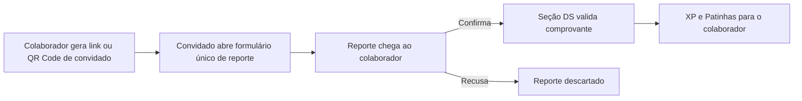
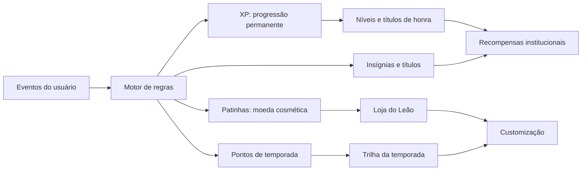

# Prompt de evolução v2: App Rede Solidária WEG, gamificação

> Versão 2.0, outubro de 2026, Seção Desenvolvimento Social | Departamento de Sustentabilidade
> Uso interno. Cole este prompt na sessão de desenvolvimento aberta no repositório do app. Ele complementa a especificação `docs/prompt_app_rede_solidaria.md` e o `README.md`, que continuam valendo em tudo o que não for alterado aqui. Trechos marcados com **[A CONFIRMAR]** dependem de decisão da equipe.

---

## 0. Como trabalhar nesta etapa

Você está evoluindo um protótipo que já existe (React, TypeScript, Vite, Tailwind, PWA, dados em `localStorage` atrás de `src/data/db.ts` e `src/domain/servicos.ts`). Leia o `README.md`, a especificação em `docs/` e a estrutura de `src/` antes de alterar qualquer coisa. Preserve a arquitetura em camadas: regras em `src/domain/`, persistência em `src/data/`, textos em `src/i18n/pt-BR.ts`.

Execute na ordem das fases da seção 10. Ao fim de cada fase, rode `npm test` e `npm run build`, corrija o que quebrar e só então avance. Atualize o `README.md` e a especificação em `docs/` com o que mudou.

O foco desta etapa é **ampliar, fortalecer e evoluir todos os elementos de gamificação**. Antes disso, corrija o bug da seção 1 e aplique as mudanças de regra das seções 2 e 3.

## 1. Prioridade zero: tela branca ao trocar de página

**Sintoma:** ao navegar entre páginas, o app fica em tela branca e só volta a carregar após recarregar o navegador.

Reproduza o problema antes de corrigir, em três ambientes: `npm run dev`, `npm run preview` (build com service worker) e o arquivo único `demo/rede-solidaria.html` aberto por duplo clique. Leia o console do navegador em cada caso e corrija a **causa raiz**. Um recarregamento automático não é solução. Investigue, nesta ordem:

| Suspeita | O que verificar | Correção esperada |
|---|---|---|
| Erro de renderização sem tratamento | Exceção em algum componente (dado `undefined` após navegar, componente 3D) derruba a árvore inteira | `ErrorBoundary` global e por rota, com tela amigável do leãozinho e botão "Tentar novamente", reiniciada a cada mudança de rota |
| Rotas com carregamento sob demanda | `React.lazy` sem `Suspense` ou falha ao baixar um chunk | `Suspense` com esqueleto de carregamento em todas as rotas; tratar `vite:preloadError` e falhas de import com uma nova tentativa controlada |
| Service worker do PWA servindo versão antiga | O `index.html` em cache aponta para chunks que não existem mais | `registerType: 'autoUpdate'`, `cleanupOutdatedCaches`, `navigateFallback` para `index.html`, aviso de "nova versão disponível" |
| Arquivo único aberto em `file://` | `BrowserRouter` não funciona fora de um servidor | Usar `HashRouter` quando o protocolo for `file:` ou no build `build:arquivo` |
| Contexto WebGL do visualizador 3D | Canvas não é descartado ao sair da página de pins, gerando perda de contexto | Liberar recursos ao desmontar, `frameloop="demand"`, limitar a um canvas ativo |
| Estado do repositório local | `useBanco` notifica componentes já desmontados ou entrega estado mutado | Assinatura e cancelamento corretos, dados imutáveis |

Crie um teste ponta a ponta (Playwright) que entra com cada perfil de teste, percorre todas as rotas do menu e do painel e falha se a raiz `#root` ficar vazia ou se houver erro no console. Esse teste passa a fazer parte de `npm test`.

## 2. Mudança de regra: convidado sem cadastro

O app é exclusivo para colaboradores WEG. O **convidado deixa de ser um perfil**: não tem login, não tem cadastro e não acessa nenhuma tela do app. Ele apenas reporta uma destinação **em nome de um colaborador**, que recebe o XP.

**Fluxo novo**

- Na tela **Convidar**, o colaborador gera um link pessoal e um QR Code de "Reporte de convidado", já vinculado a ele.
- O link abre uma página isolada, a única rota acessível sem login, que contém somente o formulário: nome do convidado, relação com o colaborador (amigo, familiar não cadastrado, vizinho, outro), modalidade, fundo, município, valor, data, comprovante e consentimento LGPD. Não há menu, ranking ou qualquer outro conteúdo do app.
- O reporte aparece para o colaborador em "Reportes de convidados", onde ele confirma ou recusa. Confirmado, segue para a fila da Seção DS.
- Validado, o XP vai **para o colaborador**. O convidado não acumula XP e não aparece em ranking.
- Limite de 10 reportes de convidado por colaborador por edição, configurável no painel.
- A página do formulário tem proteção contra abuso (limite de envios por link e por dispositivo, validação de arquivo).
- **[A CONFIRMAR com a TI]** Se a política não permitir nenhuma rota pública, o plano alternativo é o próprio colaborador lançar o reporte do convidado no app, na opção "Reportar por um convidado", anexando o comprovante recebido.

**Remover:** o perfil Convidado do login simulado, as rotas `/cadastro-convidado` e `/padrinho`, o ranking "Família e Amigos" e a tabela `vinculos_convidado`. Converter a usuária de exemplo Helena Rodrigues em um reporte de convidado vinculado à Camila. Reescrever o critério de aceite 2 e o teste correspondente.

## 3. Carta de destinação: modelo oficial

O modelo oficial recebido foi escrito para pessoa jurídica (IRPJ, Lucro Real). Como o app é usado por pessoas físicas, implemente o modelo com **duas variantes**, mantendo a mesma estrutura e redação:

- **Pessoa física (padrão do app)**, usada pelo colaborador e pelos familiares.
- **Pessoa jurídica**, disponível apenas no painel administrativo, para destinações institucionais da WEG.

**Texto, variante pessoa física**

> **CARTA DE DIRECIONAMENTO DE DESTINAÇÃO DE IMPOSTO DE RENDA**
>
> À
> {Nome do Conselho, ex.: Conselho Municipal dos Direitos da Criança e do Adolescente de Jaraguá do Sul (CMDCA) | Conselho Municipal dos Direitos da Pessoa Idosa (CMDPI)}
>
> Ref.: Direcionamento de Recursos Incentivados ({FIA | Fundo do Idoso})
>
> Prezado(a) Presidente do Conselho,
>
> Eu, {Nome completo do doador}, inscrito(a) no CPF sob o nº {000.000.000-00}, residente na {Endereço completo}, venho por meio desta informar a realização de destinação de recursos incentivados, com base nos benefícios fiscais do Imposto de Renda Pessoa Física (IRPF), conforme legislação vigente.
>
> O depósito foi realizado na conta bancária deste Fundo no valor de R$ {0.000,00} ({valor por extenso}), em {DD/MM/AAAA}.
>
> Solicito formalmente que este recurso seja integralmente direcionado e aplicado no projeto social abaixo indicado:
>
> - Instituição Beneficiária: {Nome da entidade}
> - CNPJ da Instituição: {CNPJ da entidade}
> - Nome do Projeto: {Nome exato do projeto aprovado pelo Conselho}
> - Número do Registro/Chancela: {Número do projeto ou da aprovação no Diário Oficial, se houver}
>
> Solicito, outrossim, a emissão do respectivo Recibo de Destinação em meu nome, contendo nome completo, CPF, data e o valor depositado, para fins de comprovação junto à Secretaria da Receita Federal do Brasil.
>
> Seguem anexos os comprovantes de depósito/transferência bancária.
>
> {Cidade - UF}, {DD de mês de AAAA}.
>
> ______________________
> {Nome completo do doador}

**Variante pessoa jurídica:** usar o texto oficial sem alterações ("A empresa {Razão Social}, inscrita no CNPJ sob o nº..., com sede na..., ... Imposto de Renda Pessoa Jurídica (IRPJ, Lucro Real)... em nome da nossa empresa, contendo a razão social, CNPJ...").

**Preenchimento automático**

| Campo | Origem |
|---|---|
| Nome do Conselho, sigla e tipo de fundo | Cadastro do fundo |
| Nome, CPF e endereço do doador | Perfil do colaborador ou, se a carta for de um familiar, dados informados no momento da geração |
| Valor, valor por extenso e data do depósito | Formulário da carta (extenso gerado automaticamente) |
| Instituição, CNPJ, projeto e chancela | Cadastro da entidade chancelada |
| Cidade, UF e data por extenso | Município do fundo e data de emissão |
| Código único e QR Code de verificação | Sistema, no rodapé |

Se o número de chancela não existir no cadastro, a linha mostra "Não se aplica". O CPF de familiares usado na carta não é armazenado após a geração. Ao final do fluxo, o app lembra que o comprovante bancário deve ser anexado à carta e oferece o atalho para reportar a doação.

## 4. Visão da gamificação

A gamificação passa a funcionar como um sistema único, orientado a eventos. Toda ação relevante do usuário gera um **evento**. Um **motor de regras** avalia os eventos contra missões, insígnias, temporadas e níveis, e concede **recompensas**. Tudo é configurável no painel, auditável e reversível (estorno quando um reporte é devolvido).

**Princípios que valem para todo o sistema**

1. O XP e as recompensas premiam **participação, aprendizado e mobilização**, nunca o valor doado.
2. No máximo uma missão por temporada envolve a destinação em si. As demais tratam de aprender, conhecer, conectar e compartilhar.
3. Nenhum item pode ser comprado com dinheiro, e nada tem valor monetário. As Patinhas compram apenas itens cosméticos.
4. Sem punição: ninguém perde nível, título ou item por ficar sem acessar. As sequências contam temporadas e edições, não dias.
5. Equidade: limites diários evitam que quem tem mais tempo livre dispare na frente.
6. Respeito ao bem-estar: animações respeitam `prefers-reduced-motion`, sons ficam desligados por padrão e o usuário pode ocultar-se do ranking e do mural.

### 4.1 Eventos rastreados

`reporte_validado`, `reporte_familiar_validado`, `reporte_convidado_validado`, `doacao_direta_validada`, `carta_gerada`, `convite_enviado`, `convite_aceito`, `link_convidado_gerado`, `projeto_visitado`, `entidade_visitada`, `entidade_favoritada`, `licao_guia_concluida`, `quiz_concluido`, `pergunta_do_dia_respondida`, `historia_lida`, `checkin`, `conquista_compartilhada`, `reacao_enviada`, `missao_concluida`, `nivel_alcancado`, `item_equipado`, `alcateia_criada`, `alcateia_meta_batida`, `simulador_usado`, `pin_visualizado`, `perfil_completo`.

Cada evento é gravado com usuário, tipo, dados, data e hora (fuso America/Sao_Paulo), e o motor garante idempotência (o mesmo evento nunca premia duas vezes).

## 5. Economia do jogo

| Recurso | Para que serve | Como se ganha | Pode ser gasto? |
|---|---|---|---|
| **XP** | Nível e título de honra, permanente entre edições | Todas as ações (tabela da especificação v1, mantida) | Não |
| **XP da edição** | Ranking da edição | Mesmo XP, zerado a cada edição | Não |
| **Pontos de temporada** | Avançar na Trilha da Temporada | Igual ao XP ganho dentro da temporada | Não |
| **Patinhas** | Comprar cosméticos na Loja do Leão | Missões, níveis, insígnias, trilha | Sim, só em cosméticos |

**Patinhas ganhas (valores iniciais, editáveis)**

| Fonte | Patinhas |
|---|---|
| Missão diária | 5 a 10 |
| Todas as diárias do dia (Baú do Dia) | +15 |
| Missão semanal | 20 a 40 |
| Todas as semanais (Baú da Semana) | +60 |
| Subida de nível | 30 × número do tier |
| Insígnia conquistada | 25 (comum) a 150 (lendária) |
| Destinação própria validada | 100 |
| Degraus da trilha | conforme a trilha |

**Preços na Loja do Leão:** comum 50, incomum 120, rara 250, épica 500. Itens lendários não são vendidos, só conquistados.

**Raridades e cores (sem vermelho)**

| Raridade | Cor |
|---|---|
| Comum | `#8A99A8` |
| Incomum | `#00BEDF` |
| Rara | `#0063A7` |
| Épica | `#6B4FBB` |
| Lendária | `#C9A227` |

## 6. Níveis, tiers e títulos de honra

Os níveis passam de 6 para **25**, agrupados em **5 tiers**. A curva é `XP(n) = 100 × (n − 1)^1,75`, arredondada a múltiplos de 50. Um participante casual chega ao tier 2 no primeiro ano. Um participante muito engajado leva cerca de três edições para alcançar o nível 25.

Os títulos têm **forma masculina, feminina e neutra**, escolhida pelo usuário no perfil. Os nomes dos tiers usam "Leão" ou "Leoa" conforme essa escolha, e a forma neutra usa o nome do tier sem flexão (ex.: "Tier Protetor").

| Nível | XP acumulado | Título de honra | Tier |
|---|---|---|---|
| 1 | 0 | Recém-chegado(a) à Rede | **Filhote** |
| 2 | 100 | Primeiro Rugido | Filhote |
| 3 | 350 | Pata Amiga | Filhote |
| 4 | 700 | Coração Aberto | Filhote |
| 5 | 1.150 | Semente do Bem | Filhote |
| 6 | 1.650 | Jovem Leão / Jovem Leoa | **Jovem Leão / Jovem Leoa** |
| 7 | 2.300 | Elo da Rede | Jovem |
| 8 | 3.000 | Voz da Comunidade | Jovem |
| 9 | 3.800 | Multiplicador(a) do Bem | Jovem |
| 10 | 4.700 | Juba Dourada | Jovem |
| 11 | 5.600 | Leão Protetor / Leoa Protetora | **Protetor(a)** |
| 12 | 6.650 | Escudo da Infância | Protetor(a) |
| 13 | 7.750 | Abraço da Pessoa Idosa | Protetor(a) |
| 14 | 8.900 | Construtor(a) de Pontes | Protetor(a) |
| 15 | 10.150 | Farol da Cidade | Protetor(a) |
| 16 | 11.450 | Leão Guardião / Leoa Guardiã | **Guardião / Guardiã** |
| 17 | 12.800 | Guardião(ã) do Futuro | Guardião / Guardiã |
| 18 | 14.250 | Pilar da Rede | Guardião / Guardiã |
| 19 | 15.750 | Coração de Leão | Guardião / Guardiã |
| 20 | 17.300 | Mestre(a) da Solidariedade | Guardião / Guardiã |
| 21 | 18.900 | Lenda da Rede | **Lenda** |
| 22 | 20.600 | Lenda Viva | Lenda |
| 23 | 22.350 | Patrono(a) da Comunidade | Lenda |
| 24 | 24.150 | Grande Rugido | Lenda |
| 25 | 26.000 | Lenda Eterna | Lenda |

**Prestígio:** depois do nível 25, a cada 4.000 XP o usuário ganha uma **Estrela de Lenda**, exibida ao lado do nome. A moldura de Lenda evolui com 1, 5 e 10 estrelas.

**O que cada nível entrega**
- Todo nível: Patinhas (30 × tier) e animação de subida com o leãozinho.
- Níveis 5, 10, 15, 20 e 25: moldura exclusiva do tier.
- Primeiro nível de cada tier: novo título, nova cor de juba para o avatar e novo tema do app.
- Níveis 10, 15, 20 e 25: liberam recompensas institucionais (seção 8.7).

Além do título do nível, o usuário pode exibir um **título especial** conquistado por insígnias (ex.: "Guardiã da Infância", "Veterano de 10 edições", "Embaixadora", "Pioneiro"). No perfil, ele escolhe qual título aparece sob o nome.

## 7. Status e perfil expandidos

O perfil vira um **cartão de jogador**, compartilhável sem valores.

**Cabeçalho:** avatar com moldura, nome, título escolhido, nível, tier, estrelas de prestígio e barra de XP.

**Vitrine:** 3 espaços para as insígnias favoritas, mais 1 espaço extra no tier Guardião e outro no tier Lenda.

**Radar de impacto:** gráfico de radar com cinco atributos de 0 a 100, calculados por faixas de quantidade (nunca por valor):

| Atributo | Calculado a partir de |
|---|---|
| Generosidade | Destinações próprias, de familiares e de convidados validadas, edições participadas |
| Influência | Convites aceitos, links de convidado com reporte validado, compartilhamentos |
| Conhecimento | Lições do guia, quizzes, perguntas do dia |
| Conexão | Projetos e entidades visitados e favoritados, histórias lidas |
| Constância | Edições e temporadas consecutivas, missões concluídas |

**Estatísticas:** XP total, XP da edição, posição no ranking e percentil, edições participadas, sequência de edições, destinações reportadas (quantidade), familiares e convidados engajados, convites aceitos, missões concluídas, projetos conhecidos, insígnias (x de y), pins (x de y), itens da coleção por categoria.

**Linha do tempo:** uma faixa por edição, com o pin do ano, o nível alcançado e as insígnias conquistadas naquela edição.

## 8. Elementos de gamificação

### 8.1 Customização do avatar e do perfil

O avatar padrão é o **leãozinho oficial com camadas de personalização**. O colaborador também pode usar foto (que, futuramente, virá do SSO).

| Categoria | Exemplos | Como se obtém |
|---|---|---|
| Cor da juba | Clássica, ciano, azul-noite, prata, dourada | Tiers e trilha |
| Acessório de cabeça | Capacete de segurança azul, boné da Rede Solidária, fones, coroa de folhas (lendária) | Loja, trilha, níveis |
| Acessório de rosto | Óculos de proteção, óculos redondos | Loja, missões |
| Acessório de pescoço | Cachecol azul e ciano, crachá, medalha | Loja, insígnias |
| Item na pata | Livro (Conhecimento), coração, chave inglesa, megafone (Influência) | Insígnias e atributos do radar |
| Fundo do avatar | Gradiente azul, céu noturno, serra de Jaraguá, Parque Fabril | Loja, eventos |
| Moldura | Moldura de cada tier, da edição, de eventos, de prestígio | Níveis, trilha, eventos |
| Banner do perfil | Ilustrações temáticas da edição e das temporadas | Trilha, loja |
| Tema do app | Claro, escuro, Azul Noturno, Ciano | Tiers |
| Efeito de subida de nível | Confete azul, chuva de patinhas, rugido luminoso | Loja, trilha |
| Estilo da linha no ranking | Destaque com a cor da raridade | Loja |
| Adesivos de reação | Aplauso, rugido, coração azul, leãozinho joinha | Missões, loja |

**Implementação**
- O avatar é um SVG em camadas sobre a arte oficial do mascote, com pontos de ancoragem por camada (`cabeca`, `rosto`, `pescoco`, `pata`, `fundo`, `moldura`).
- Cada item do catálogo tem `id`, `nome`, `categoria`, `camada`, `raridade`, `fonte` (nível, loja, trilha, insígnia, evento, missão), `arte`, `disponivel_de`/`ate` e `exclusivo_edicao`.
- Até a chegada das artes, gere os acessórios como SVG procedural simples, nas cores do programa, e mantenha a troca centralizada como foi feito com o `<Mascote />`.
- Tela **Personalizar** com prévia ao vivo, abas por categoria, filtros "Tenho" e "Bloqueados" e, nos itens bloqueados, indicação de como obtê-los.

### 8.2 Loja do Leão

- Vitrine de cosméticos comprados com Patinhas, com rotação semanal de 6 ofertas e uma "oferta da temporada".
- Itens de edição saem da loja ao fim da edição e viram colecionáveis.
- Antes de comprar, o usuário vê a prévia no próprio avatar.

### 8.3 Missões

**Mecânica**
- **Diárias:** 3 por dia, sorteadas para cada usuário a partir de um conjunto, com 1 troca gratuita por dia. Concluir as 3 abre o **Baú do Dia**. Reinício à meia-noite (America/Sao_Paulo). Limite de 50 XP por dia, mantido.
- **Semanais:** 5 por semana, com o **Baú da Semana** ao concluir todas. Reinício na segunda-feira.
- **Jornada do Leãozinho:** missões em capítulos, com uma narrativa curta em que o leãozinho conhece a cidade e as causas. Cada capítulo concluído entrega um item exclusivo.
- **Missões da temporada:** ligadas ao calendário (Doação Direta, Declaração, Impacto).
- **Missões relâmpago:** de 24 a 72 horas, em datas-chave (ex.: últimas duas semanas antes de 31/12, com XP em dobro nas missões educativas; Dia Internacional do Voluntariado, 5/12).
- **Missões de família e de convidados.**
- **Missões de alcateia:** coletivas, com meta somada da equipe.
- **Missões de embaixador:** exclusivas desse perfil.

**Conjunto inicial (valores editáveis no painel)**

| Tipo | Missão | XP | Patinhas |
|---|---|---|---|
| Diária | Fazer check-in no app | 10 | 5 |
| Diária | Responder a pergunta do dia do guia | 20 | 10 |
| Diária | Ler uma história de impacto | 15 | 5 |
| Diária | Visitar a página de um projeto apoiado | 15 | 5 |
| Diária | Conhecer uma entidade chancelada da sua cidade | 20 | 10 |
| Diária | Reagir à conquista de um colega no mural | 10 | 5 |
| Diária | Ver a curiosidade do leãozinho | 10 | 5 |
| Diária | Conferir o termômetro da meta | 10 | 5 |
| Semanal | Convidar 2 colegas | 100 | 40 |
| Semanal | Concluir 10 missões diárias | 80 | 30 |
| Semanal | Compartilhar um card de conquista | 60 | 20 |
| Semanal | Conhecer 3 projetos de um mesmo ODS | 70 | 25 |
| Semanal | Concluir uma lição do guia do IR | 80 | 30 |
| Semanal | Atualizar sua família no app | 50 | 20 |
| Semanal | Ajudar sua alcateia a bater a meta da semana | 100 | 40 |
| Jornada, cap. 1 "O Primeiro Rugido" | Completar perfil, montar o avatar, concluir a lição 1 do guia | 150 | 60 |
| Jornada, cap. 2 "Conhecendo a Cidade" | Visitar 5 projetos e 3 entidades do seu município | 200 | 80 |
| Jornada, cap. 3 "A Alcateia" | Entrar em uma alcateia e convidar 1 colega | 200 | 80 |
| Jornada, cap. 4 "A Grande Escolha" | Reportar a sua destinação da edição | 250 | 100 |
| Jornada, cap. 5 "Multiplicar" | Ter 1 familiar ou convidado com reporte validado | 300 | 120 |
| Temporada | Destinar antes de 31/12 (Temporada Doação Direta) | 200 | 80 |
| Temporada | Usar o simulador e concluir o quiz (Temporada Declaração) | 150 | 60 |
| Temporada | Conhecer 10 projetos (Temporada Impacto) | 150 | 60 |
| Família | Cadastrar o primeiro familiar | 50 | 20 |
| Convidado | Gerar seu link de convidado | 30 | 10 |
| Embaixador | Apresentar a Rede Solidária à sua equipe (registro com foto) | 200 | 80 |
| Embaixador | Ter 3 convites aceitos na semana | 150 | 60 |

**Construtor de missões no painel:** cada missão é definida por evento-alvo, quantidade, janela (dia, semana, temporada, edição), filtros (município do usuário, ODS, fundo), público (todos, embaixadores, tier mínimo) e recompensas. O motor da seção 4 avalia esse critério automaticamente.

### 8.4 Insígnias

As insígnias ganham **graus** (I a IV), raridade e categoria. Todas são exibidas na tela de conquistas, com progresso visível para as que ainda faltam, exceto as secretas.

| Insígnia | Graus ou critério | Categoria |
|---|---|---|
| Primeira Destinação | Primeira destinação validada na vida | Participação |
| Dupla Proteção | FIA e Fundo do Idoso na mesma edição | Participação |
| Família Solidária I a III | 2, 3 e 5 membros da família na mesma edição | Família |
| Rede Ampliada I a III | 1, 3 e 10 reportes de convidados validados | Influência |
| Multiplicador(a) I a IV | 1, 5, 15 e 30 convites aceitos | Influência |
| Voz da Rede | 10 conquistas compartilhadas | Influência |
| Veterano(a) I a IV | 3, 5, 10 e 15 edições | Constância |
| Pioneiro(a) | Participação anterior ao app | Constância |
| Antecipado(a) | Doação direta até 31/12 | Participação |
| Madrugador(a) da Temporada | Missão da temporada concluída na primeira semana | Constância |
| Explorador(a) de Projetos I a III | 5, 15 e 40 projetos visitados | Conexão |
| Guardião(ã) do Município | Todas as entidades do seu município visitadas | Conexão |
| Conhecedor(a) do Guia | Todas as lições do guia concluídas | Conhecimento |
| Mestre(a) do Quiz | Quiz com 100% em 3 edições | Conhecimento |
| Missionário(a) I a IV | 50, 150, 400 e 1.000 missões | Constância |
| Semana Perfeita | Todas as semanais de uma semana | Constância |
| Temporada Completa | Trilha da temporada concluída | Constância |
| Colecionador(a) de Pins I a III | 5, 10 pins e coleção completa | Coleção |
| Alcateia Unida | Alcateia bateu 4 metas semanais seguidas | Equipe |
| Embaixador(a) | Atribuída pelo administrador | Especial |
| Secretas | Ex.: tocar 5 vezes no leãozinho da página inicial, abrir o glossário completo, acessar no Dia Internacional do Voluntariado | Secreta |

### 8.5 Trilha da Temporada

- Cada temporada tem uma **trilha gratuita de 25 degraus**, e cada degrau exige 80 pontos de temporada (valores editáveis).
- Os degraus entregam Patinhas, cosméticos da temporada e, no último, um item épico exclusivo e a insígnia Temporada Completa.
- Visual em caminho ilustrado, com o leãozinho avançando pelos degraus.
- Ao fim da temporada, os itens não resgatados ficam disponíveis por mais 7 dias.

### 8.6 Alcateias, mural e ranking

**Alcateias (equipes):** o colaborador cria ou entra em uma alcateia de até 15 pessoas (setor, turno, turma). Cada alcateia tem nome, emblema escolhido no catálogo, meta semanal coletiva de missões e um ranking próprio. Bater a meta da semana entrega um bônus a todos os membros.

**Mural da Rede:** feed de conquistas da unidade e das alcateias (subida de tier, insígnias raras, trilha concluída), com reações por adesivos e sem comentários abertos. A participação é opcional, e o usuário pode ocultar suas conquistas. Valores nunca aparecem.

**Ranking ampliado**
- Abas: Pessoas, Alcateias, Unidades, Cidades.
- Período: semana, temporada, edição, histórico.
- Recortes Top 5, Top 10 e Top 100, mantidos.
- Pódio ilustrado para os 3 primeiros, com avatar e moldura.
- Indicador de subida ou queda de posição em relação à semana anterior.
- **Fase futura [A CONFIRMAR]:** ligas por temporada (Bronze, Prata, Ouro, Diamante, Lenda), com grupos de 30 pessoas e promoção ao fim de cada temporada.

### 8.7 Recompensas institucionais

Separadas dos cosméticos, ficam na tela **Recompensas**, com requisito (nível, tier ou insígnia), estoque, limite de 1 por pessoa por edição e solicitação acompanhada pela Seção DS. Catálogo inicial, todo **[A CONFIRMAR]**:

| Categoria | Recompensa | Requisito sugerido |
|---|---|---|
| Reconhecimento | Certificado especial do tier | Primeiro nível de cada tier |
| Reconhecimento | Menção no evento de reconhecimento | Tier Lenda |
| Produto | Pelúcia do leãozinho | Nível 10 |
| Produto | Kit Rede Solidária (caneca, adesivos, boné) | Nível 15 |
| Experiência | Visita guiada a uma entidade apoiada | Nível 10 |
| Experiência | Convite para o evento de reconhecimento com acompanhante | Nível 20 |
| Experiência | Café com a equipe da Seção Desenvolvimento Social | Insígnia Multiplicador(a) III |
| Experiência | Participação em ação do Coração Voluntário | Insígnia Guardião(ã) do Município |
| Voucher | A definir com a área responsável | A definir |

**Voto do Leão [A CONFIRMAR]:** a cada tier, o usuário ganha votos para indicar, entre projetos chancelados selecionados pela Seção DS, qual deles deve receber um apoio adicional da WEG com recursos próprios ao fim da edição. O resultado aparece na página inicial.

Regras que permanecem: recompensas oferecidas exclusivamente pela WEG, de valor simbólico, nunca vinculadas ao valor destinado e sujeitas à validação de Compliance e Jurídico.

### 8.8 Sensação de jogo

- Subida de nível em tela cheia, com o leãozinho, o novo título e os itens desbloqueados.
- Notificações flutuantes com "+20 XP" e "+10 Patinhas" após cada ação.
- Anéis de progresso nas missões e na trilha.
- Vibração curta no celular nas conquistas (quando houver suporte).
- Sons opcionais, desligados por padrão.
- Estados vazios com o leãozinho incentivando a próxima ação.
- Página inicial com um bloco "Sua próxima conquista", que mostra a missão ou insígnia mais próxima de ser concluída.

## 9. Painel administrativo e dados

**Novas áreas do painel:** catálogo de itens cosméticos (com envio de arte e raridade), níveis e títulos, construtor de missões, insígnias e critérios, temporadas e trilhas, preços e ofertas da loja, recompensas institucionais e resgates, alcateias (moderação de nomes), mural (ocultar publicações), Voto do Leão e reportes de convidados.

**Analytics de gamificação:** usuários ativos por dia e por semana, taxa de conclusão de cada missão, avanço médio na trilha, distribuição por nível e tier, itens mais usados, conversão de links de convidado e um **simulador de economia**, que projeta XP e Patinhas por perfil de usuário (casual, regular, engajado) para ajustar a curva antes de publicar mudanças.

**Novas tabelas:** `eventos`, `itens`, `usuario_itens`, `avatar_config`, `titulos`, `usuario_titulo`, `transacoes_patinhas`, `ofertas_loja`, `trilhas`, `trilha_degraus`, `usuario_trilha`, `missoes_criterios`, `usuario_missoes_diarias`, `alcateias`, `alcateia_membros`, `mural_posts`, `reacoes`, `votos`, `links_convidado`, `reportes_convidado`.

**Removida:** `vinculos_convidado`.

Os dados de exemplo devem cobrir usuários em todos os tiers, incluindo um com estrelas de prestígio, além de 3 alcateias, trilha em andamento, itens em todas as raridades e reportes de convidado em todos os status.

## 10. Fases de entrega

| Fase | Entrega |
|---|---|
| 0 | Correção da tela branca e teste de navegação ponta a ponta |
| 1 | Convidado sem cadastro e carta oficial nas duas variantes |
| 2 | Motor de eventos e regras, economia (XP, Patinhas, pontos de temporada) e estorno |
| 3 | 25 níveis, tiers, títulos com variação de gênero, prestígio e perfil expandido com radar |
| 4 | Avatar em camadas, catálogo de itens, tela Personalizar e Loja do Leão |
| 5 | Missões novas, baús, Jornada do Leãozinho e construtor de missões |
| 6 | Insígnias com graus e Trilha da Temporada |
| 7 | Alcateias, mural e ranking ampliado |
| 8 | Recompensas institucionais, Voto do Leão e analytics de gamificação |

## 11. Critérios de aceite desta etapa

1. Navegar por todas as rotas, em todos os perfis, nunca resulta em tela branca, nos três ambientes (dev, preview e arquivo único).
2. Não existe perfil Convidado no login. O link de convidado abre somente o formulário, o colaborador confirma o reporte e, após a validação, o XP vai para ele.
3. A carta é gerada nas variantes pessoa física e pessoa jurídica, com todos os campos automáticos e "Não se aplica" quando não houver chancela.
4. O mesmo evento nunca premia duas vezes, e a devolução de um reporte estorna XP, Patinhas, pontos de temporada e insígnias derivadas.
5. A curva de 25 níveis segue a tabela da seção 6, e os títulos respeitam a forma de gênero escolhida.
6. Itens comprados com Patinhas aparecem na prévia e no avatar equipado. Itens lendários não estão à venda.
7. As diárias são sorteadas por usuário, reiniciam à meia-noite de Brasília e respeitam o limite de 50 XP por dia.
8. Nenhuma tela, card, mural ou ranking exibe valores doados.
9. Todas as missões, insígnias, níveis, itens, preços e trilhas são editáveis no painel sem alterar código.
10. Nenhum elemento usa a cor `#C8102E` (o teste automatizado existente continua passando).

## 12. Regras permanentes do projeto (criar `CLAUDE.md` na raiz)

Crie um `CLAUDE.md` na raiz do repositório com as regras abaixo, para que toda sessão de desenvolvimento futura as siga sem depender deste prompt:

- Nunca usar o vermelho `#C8102E`. Paleta: `#00325C`, `#0063A7`, `#095BA7`, `#00BEDF` e as cores de raridade da seção 5.
- O mascote aparece sempre pelo componente `<Mascote />`, e os acessórios do avatar seguem o catálogo central.
- XP, Patinhas e recompensas nunca dependem do valor doado, e valores nunca aparecem fora da área pessoal do usuário e do painel.
- O app é exclusivo para colaboradores WEG. A única rota sem login é o formulário de convidado.
- Toda regra de jogo vive em `src/domain/`, é configurável no painel e tem teste.
- Textos em `src/i18n/pt-BR.ts`, datas DD/MM/AAAA, moeda R$, fuso America/Sao_Paulo.
- Antes de concluir qualquer tarefa: `npm test` e `npm run build` sem erros, e o teste de navegação sem tela branca.
---

## Anexo: notas de implementação (outubro de 2026)

Registro do que foi entregue a partir deste prompt e das decisões tomadas onde o texto deixou espaço.

**Fase 0 (tela branca).** A causa raiz foi reproduzida e corrigida (detalhes no histórico do Git). Depois disso, o teste de navegação ponta a ponta (`e2e/navegacao.spec.ts`) achou mais um caso: a Coleção de pins registrava `pin_visualizado` num `useEffect` que dependia de objetos do banco; como toda gravação gera cópias novas, a tela entrava em laço de atualização (erro React #185) e caía na tela de erro. Correção: o serviço `registrar` não grava nem notifica quando o evento idempotente já existe, e a tela passou a depender de valores primitivos (hook `useEstavel`). Há teste unitário para isso.

**Fases 1 a 8.** O motor de eventos (fase 2) é a base de todas as outras, por isso as fases 2 a 8 foram construídas juntas sobre ele e testadas em conjunto; `npm test` e `npm run build` passam ao final.

**Modelo de dados (equivalência com a seção 9).** No protótipo cada tabela é uma coleção em `src/data/db.ts`:

| Tabela do prompt | Coleção no protótipo |
|---|---|
| `eventos` | `eventos` (com `chave` de idempotência, `raiz` para estorno em cascata e `dia` no fuso de Brasília) |
| `itens`, `usuario_itens` | `itens`, `usuarioItens` |
| `avatar_config`, `usuario_titulo` | campos `avatar` e `tituloEscolhido` do usuário |
| `titulos` | títulos dos níveis (`niveis[].titulo` com formas m/f/n) e das insígnias |
| `transacoes_patinhas` | `transacoesPatinhas` |
| `ofertas_loja` | calculadas por semana a partir da semente em `configuracoes.lojaRotacaoSemente` (sem tabela) |
| `trilhas`, `trilha_degraus`, `usuario_trilha` | `temporadas[].trilha` e `usuarioTrilhas` |
| `missoes_criterios`, `usuario_missoes_diarias` | `missoes[].criterios` e `sorteios` (diárias e semanais sorteadas por usuário) |
| `alcateias`, `alcateia_membros`, `mural_posts`, `reacoes`, `votos` | coleções com os mesmos nomes em camelCase |
| `links_convidado` | `linksConvidado` (com envios por dispositivo para o antiabuso) |
| `reportes_convidado` | `reportes` com o campo `convidado` (nome, relação, link), para que validação, estorno e relatórios usem o mesmo fluxo |

**Eventos adicionais** (além da lista 4.1): `multiplicacao_validada`, `alcateia_entrou`, `familia_atualizada`, `curiosidade_vista`, `meta_conferida`, `mascote_tocado`, `glossario_termo_aberto`, `apresentacao_registrada`, `bau_aberto`. Servem de alvo para missões e insígnias.

**Pontos de temporada** são o XP ganho dentro do período da temporada ativa; não há saldo separado.

**Carta PJ.** O texto oficial integral de pessoa jurídica não veio no prompt (apenas o trecho entre aspas na seção 3). A variante PJ foi montada a partir do texto PF com as substituições indicadas (razão social, CNPJ, sede, IRPJ Lucro Real, "em nome da nossa empresa"). **[A CONFIRMAR]** com o modelo oficial completo.

**Seed.** Pessoas em todos os tiers, incluindo a Ana Paula Schmitt no nível 25 com duas estrelas de prestígio; três alcateias; Camila (colaboradora de teste) no tier 2 com a trilha em andamento; itens de todas as raridades (os lendários vêm dos níveis 21 e 25); reportes de convidado em todos os status (o da Helena Rodrigues aguarda a confirmação da Camila).

**Exceção à rota única sem login.** Além do formulário de convidado (`/r/:codigo`), a página `/verificar/:codigo`, aberta pelo QR Code impresso na carta, continua pública para que o fundo ou o conselho confira a autenticidade. Ela mostra só código, data de emissão e projeto (sem nome do doador nem valor). **[A CONFIRMAR]** se deve exigir login.
